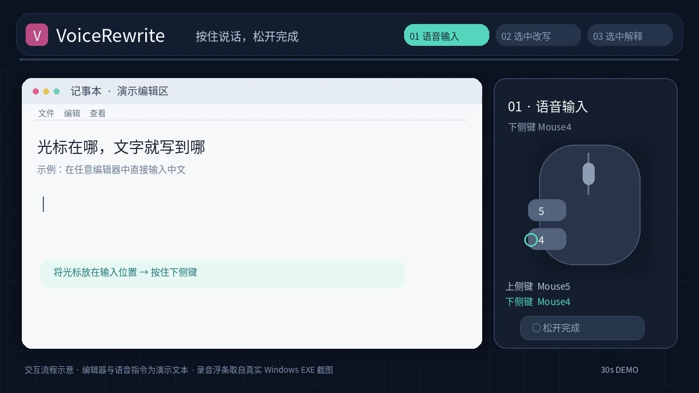

[▶ Watch the 30-second demo](docs/demo/voicerewrite-demo.mp4)

# VoiceRewrite

**Hold a mouse side button to speak, then release to insert your words.** For Windows 11.

## 🚀 Quick start (Windows)

### 1. Download OneClick and double-click to start speech recognition

**[⬇ Download Qwen3-ASR-OneClick-Windows-x64.exe](https://github.com/xujinheng/windows-voice-rewrite/releases/download/v0.1.1/Qwen3-ASR-OneClick-Windows-x64.exe)**

Save the EXE somewhere easy to find and **double-click it**. No installation, extraction, terminal, or coding is required. On first launch it downloads the speech model and runtime automatically. You'll need internet access and several GB of free storage.

When the console shows **`READY!`**, leave that window open: closing it stops speech recognition. Subsequent launches reuse downloaded files.

### 2. Download and install VoiceRewrite

**[⬇ Download VoiceRewrite-Setup-0.1.1-x64.exe](https://github.com/xujinheng/windows-voice-rewrite/releases/download/v0.1.1/VoiceRewrite-Setup-0.1.1-x64.exe)**

This is a **Windows installer (EXE), not a ZIP**. Double-click, follow the installer, then open VoiceRewrite. If you don't see its window, open Settings from the tray icon at the bottom-right of the taskbar.

The installer currently has no Windows publisher signature. If Windows shows a security warning, verify that the file came from this project's GitHub Release before deciding to run it.

### 3. Hold the lower mouse side button to dictate

Click in a text field in Notepad, a browser, or a chat app. **Hold the lower side button (Mouse4), speak, and release**. VoiceRewrite will attempt to insert your words at the cursor.

No mouse side buttons? Change the dictation shortcut in VoiceRewrite Settings.

## ✨ Want AI rewriting, translation, or explanations?

OneClick is enough for dictation. **AI text actions also require a language model**:

[⬇ Download LM Studio (official site)](https://lmstudio.ai/)

Download and load a chat model in LM Studio, then turn on its local API server (normally `http://127.0.0.1:1234/v1`). Check the text-model connection in VoiceRewrite Settings. Select text, hold the **upper side button (Mouse5)**, say something like “make this more natural,” and release.

## 🍎 macOS (experimental · currently unstable)

**The macOS version may still fail to dictate, insert text, or handle the clipboard. It is not recommended as a reliable daily driver.**

- **[⬇ Apple Silicon (M-series) experimental ZIP](https://github.com/xujinheng/windows-voice-rewrite/releases/download/v0.1.1/VoiceRewrite-0.1.1-macOS-arm64-Experimental.zip)**
- **[⬇ Intel Mac experimental ZIP](https://github.com/xujinheng/windows-voice-rewrite/releases/download/v0.1.1/VoiceRewrite-0.1.1-macOS-x86_64-Experimental.zip)**

**Extract the ZIP**, move `VoiceRewrite.app` to Applications, and try launching it. These experimental packages are not signed with an Apple Developer ID or notarized; macOS may block them. Verify their origin and consider the security implications rather than disabling system security protections. The app also requires Microphone, Accessibility, and Input Monitoring permissions.

**Windows OneClick does not run on macOS.** You must separately start a compatible ASR API server and configure `~/.config/voicerewrite/config.json`; the Mac version is **not yet plug-and-play**. Once configured, hold **Right Command** to dictate or **Right Option** to issue a rewrite instruction for selected text. See [macOS setup details](macos/Headless/README.md).

## More information

[All v0.1.1 downloads and release notes](https://github.com/xujinheng/windows-voice-rewrite/releases/tag/v0.1.1) · [Advanced Windows guide](voice-rewrite/README.md) · [Privacy](PRIVACY.md) · [Report an issue](https://github.com/xujinheng/windows-voice-rewrite/issues)

Audio and selected text go to the **local or remote API servers you configure**. Licensed under [BSD 3-Clause](LICENSE); see [third-party notices](voice-rewrite/THIRD_PARTY_NOTICES.md).
