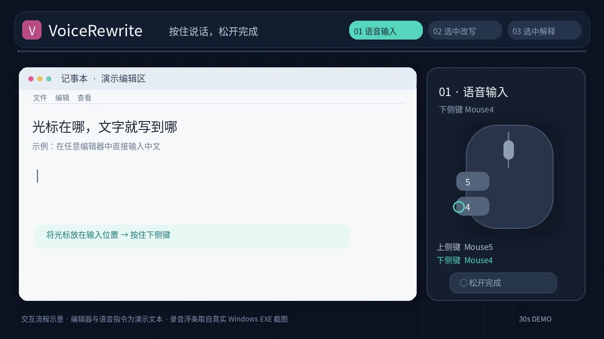

[▶ 点击观看 30 秒演示视频](docs/demo/voicerewrite-demo.mp4)

# VoiceRewrite

**按住鼠标侧键说话，松开就能输入文字。** 适用于 Windows 11。

## 🚀 三步开始（Windows）

### 1. 下载 OneClick，双击启动语音模型

**[⬇ 下载 Qwen3-ASR-OneClick-Windows-x64.exe](https://github.com/xujinheng/windows-voice-rewrite/releases/download/v0.1.1/Qwen3-ASR-OneClick-Windows-x64.exe)**

将下载的文件放在一个方便找到的文件夹里，**直接双击，不用安装、解压或敲命令**。首次运行会自动下载语音识别模型和所需程序；需要联网、数 GB 磁盘空间，下载时间取决于网速。

看到黑色窗口显示 **`READY!`** 就准备好了。**请保持这个窗口打开**，关闭它会停止语音识别服务。再次启动会复用已下载的文件。

### 2. 下载 VoiceRewrite，完成安装

**[⬇ 下载 VoiceRewrite-Setup-0.1.1-x64.exe](https://github.com/xujinheng/windows-voice-rewrite/releases/download/v0.1.1/VoiceRewrite-Setup-0.1.1-x64.exe)**

这是 **Windows 安装程序（.exe），不需要解压**。双击并按照提示安装，安装结束后打开 VoiceRewrite。如果没看到主窗口，可以在任务栏右下角找到它的托盘图标，进入「设置」。

安装包目前没有 Windows 发布者数字签名，系统可能显示安全提醒。请确认文件来自本项目的 GitHub Release 再决定是否运行。

### 3. 按住鼠标下侧键，开始听写

打开微信、记事本或浏览器输入框，把光标放在要输入文字的位置。**按住鼠标下侧键（Mouse4）说话，松开按键**，识别结果就会尝试输入到光标处。

没有鼠标侧键？在 VoiceRewrite「设置」中把听写快捷键改成自己习惯的按键。

## ✨ 想用 AI 改写、翻译或解释文字？

听写只需要上面的 OneClick。**改写/翻译/问答还需要文字 AI 模型**：

[⬇ 下载 LM Studio（官网）](https://lmstudio.ai/)

在 LM Studio 里下载并加载一个聊天模型，开启本地 API 服务（默认 `http://127.0.0.1:1234/v1`）；再在 VoiceRewrite「设置」中检查文字模型连接。选中一段文字，按住**鼠标上侧键（Mouse5）**，说出「把这段话改得更自然」等指令，再松开。

## 🍎 macOS（实验性版本 · 目前不稳定）

**macOS 目前仍可能出现听写、输入或剪贴板问题，不建议非技术用户作为日常主力使用。**

- **[⬇ Apple Silicon（M 系列）实验版 ZIP](https://github.com/xujinheng/windows-voice-rewrite/releases/download/v0.1.1/VoiceRewrite-0.1.1-macOS-arm64-Experimental.zip)**
- **[⬇ Intel Mac 实验版 ZIP](https://github.com/xujinheng/windows-voice-rewrite/releases/download/v0.1.1/VoiceRewrite-0.1.1-macOS-x86_64-Experimental.zip)**

下载 ZIP 后**双击解压**，将 `VoiceRewrite.app` 拖进「应用程序」，再尝试打开。此实验版未经过 Apple Developer ID 签名及公证；macOS 可能拦截启动，请先核对下载来源，了解安全风险，不要直接关闭系统安全保护。它还需要授予麦克风、辅助功能和输入监控权限。

**Mac ASR OneClick 已加入源码，将在后续版本提供 `Qwen3-ASR-OneClick-Mac-arm64.zip`。** 解压到可写文件夹，双击 `Start OneClick.command` 即可自动下载 Metal 运行时和 Qwen3-ASR 模型；停止程序并删除整个解压文件夹即可清理。**上面的 v0.1.1 下载尚不包含 Mac OneClick**。使用 Mac VoiceRewrite 时，仍需按其配置要求连接 ASR 服务；按住**右 Command** 听写，按住**右 Option** 改写。详见 [OneClick 说明](oneclick/README.md) 和 [macOS 配置](clients/macos/app/README.md)。

## 其他

[全部 v0.1.1 下载文件与更新说明](https://github.com/xujinheng/windows-voice-rewrite/releases/tag/v0.1.1) · [Windows 进阶使用说明](clients/windows/README.md) · [隐私说明](PRIVACY.md) · [反馈问题](https://github.com/xujinheng/windows-voice-rewrite/issues)

语音和选中文字会发送到**你配置的**本地或远程模型服务。项目按 [BSD 3-Clause 许可证](LICENSE) 发布；另见 [第三方许可说明](docs/third-party-notices.md)。
